## 💫 About me

Hi! I'm a Full-Stack Software Developer currently studying at **Universiti Teknikal Malaysia Melaka (UTeM)**.

I'm passionate about software development, AI Engineering, and industrial machine software. My goal is to bridge the gap between **software engineering, artificial intelligence, and electrical/IoT systems** by developing intelligent and integrated solutions.

<b>🎯 Interests</b> (click to expand)

 

- Full-Stack Software Development
- AI & Machine Learning
- Industrial Automation & Machine Software
- Electrical Systems & IoT Integration

Always learning, building, and exploring new technologies.

## 💻 Tech stack

**Languages**

         

**Frameworks & databases**

      

**AI, data & tools**

      

## 📊 GitHub stats

  
  

  

  

## 🐍 Contribution snake

<picture>
  <source media="(prefers-color-scheme: dark)" srcset="https://raw.githubusercontent.com/ThomsonTea/ThomsonTea/output/github-contribution-grid-snake-dark.svg">
  
</picture>

## 🌐 Socials

